# A Split Keyboard, Built from Scratch

## Overview

This is a custom split keybaord with the 1.8inch tft diaply and rotatory encoder and also with rfid nfc based lock system with the controlable backlight . This keyboard can be used as wired keybaord as well as the wireless keybaord with the 2 bluetooth profile 

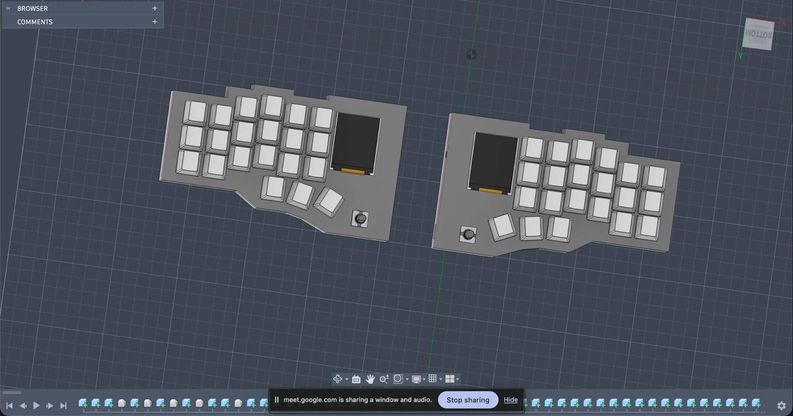

---

##  Collaboration & Attribution (Team Project)

This project was built in collaboration with my friend **Mr. Chronos** ([Chronos-03/Chronos-keybaord](https://github.com/Chronos-03/Chronos-keybaord)). Because I was learning several workflows from scratch, we worked together over live screen-sharing sessions. While our core architecture and design files look very similar due to building them side-by-side in real time, I created my own project files step-by-step alongside him and mutually debugged issues along the way.

###  Breakdown of Contributions (What I Did vs. What Chronos Did)

**What I Did Myself (Time Claimed):**
Drew the complete schematic in KiCad myself while following along in real time, verifying component connections, and helping spot/fix schematic errors during our sessions.Placed the components, routed the PCB tracks on my board, and resolved the DRC/ERC errors with his mentorship. Built the 3D enclosure step-by-step while learning CAD modeling from him. I also independently modified and fine-tuned my case design by adding rounded corners (fillets) to give it a smoother, distinct aesthetic compared to his enclosure.

**What Mr. Chronos Did (Time NOT Claimed):**
Guided me through the schematic design, PCB routing rules, error resolution, and 3D CAD workflow via screen share.The PCB panelization / mouse bites and shared fabrication prep were done directly by Mr. Chronos. **I have not claimed any time for this part.**

## Key Features

### Split Mechanical Layout

Two separate keyboard halves, each built around its own ESP32-S3 microcontroller and supporting electronics.
 Each side having 21 MX switches and with the backlight. 
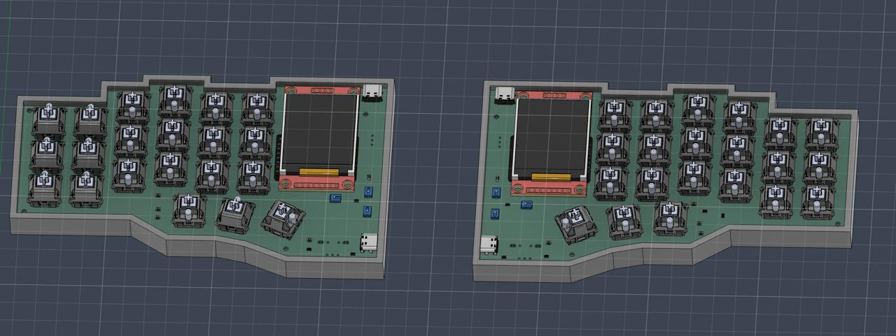

### Rotary Encoder Controls

EC11 rotary encoders provide physical controls for functions such as volume and brightness.

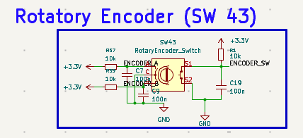

### TFT Display

Two 1.8-inch TFT displays are included for displaying system information such as battery percentage and connectivity status. Can also play animation on idle state.

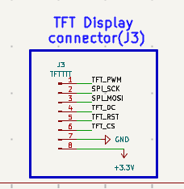

### RFID Integration

RC522 readers provide the hardware for RFID card detection and card-based interactions used to unlock the keyboard or the PC depend on the firmware either use it as the keyboard lock or use it to open the pc via your nfc tag or the phone nfc 

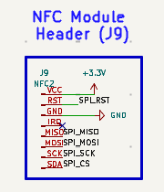

### Rechargeable Power

Each half has a rechargeable 10000 mah LiPo battery with the inbuilt BMS which power up the whole half and can provide long lasting backup on the bluetooth mode .

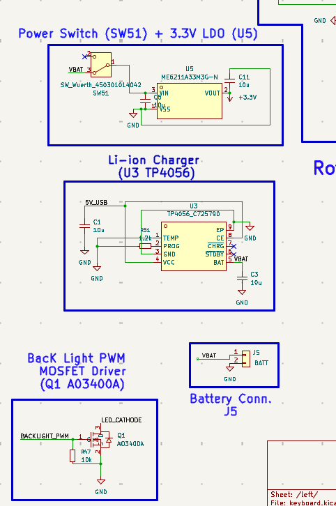

### Per-Key Backlighting

White 0805 SMD LEDs are use to work as the backlight like professional keybaord with the intensity control uc an control the backlight intensity with the same rotatory encoder 

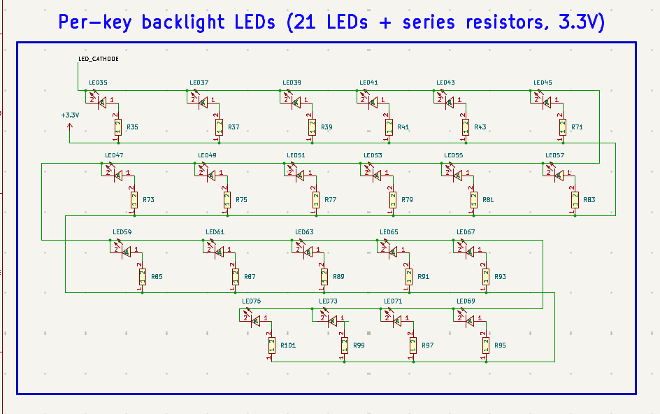

---

## Schematic Design

### Key Switch Matrix

The switch matrix connects the mechanical switches to the microcontroller. Diodes help prevent unwanted electrical paths during simultaneous key presses.

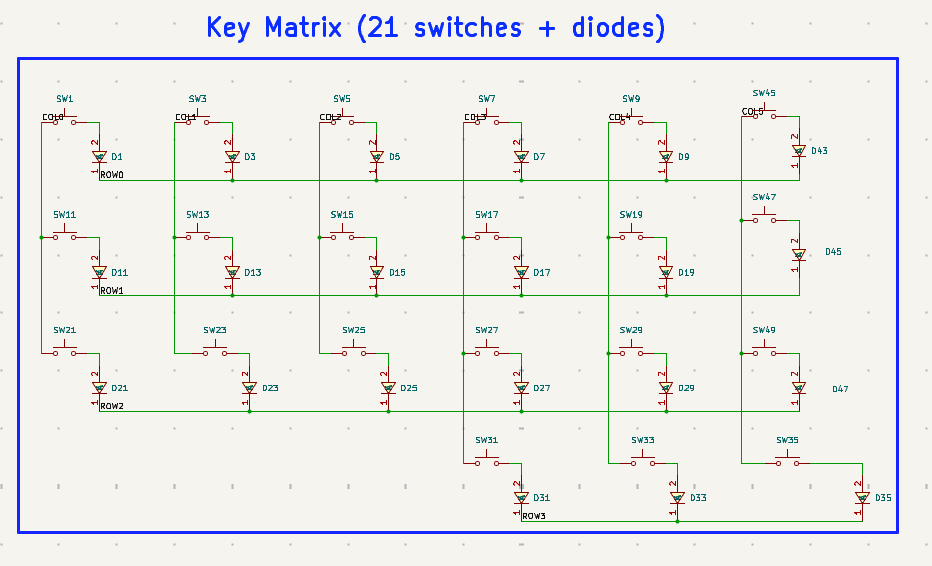

### Switches and Diodes

Mechanical switches provide individual key inputs, while 1N4148WS diodes support switch-matrix isolation.

### Resistors and LEDs

Resistors support the associated circuits, while white SMD LEDs provide per-key backlighting.

### Microcontroller

The ESP32-S3-WROOM-1-N4R8 acts as the main controller for each keyboard half.

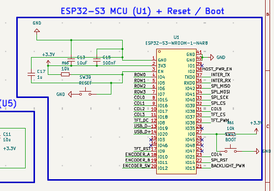

### Rotary Encoders

The EC11 encoders provide rotation and switch inputs for additional keyboard controls.

### Display Circuit

The display connections allow the ESP32-S3 to communicate with the TFT modules.

### RFID Circuit

The RC522 reader connections provide the interface for RFID card detection.

### Power Management

The power circuit includes LiPo battery charging, 3.3 V regulation, MOSFET switching, and resettable overcurrent protection.

### USB-C Connectivity

USB-C connectors provide the interfaces intended for charging, firmware uploading, and supported wired connections.

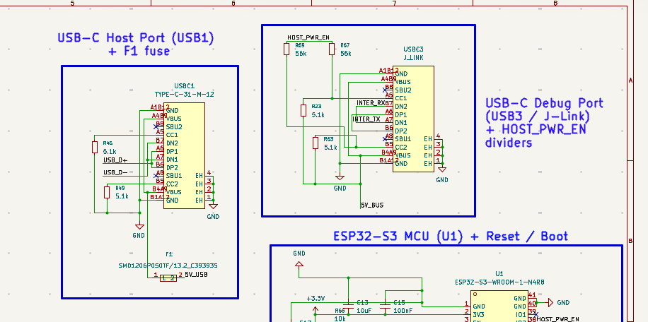

---

## PCB Design

The custom schematic and PCB layout were designed in KiCad, with the boards manufactured by Zbotic. The PCB integrates the keyboard matrix, controller connections, peripheral interfaces, backlighting, and power circuitry.

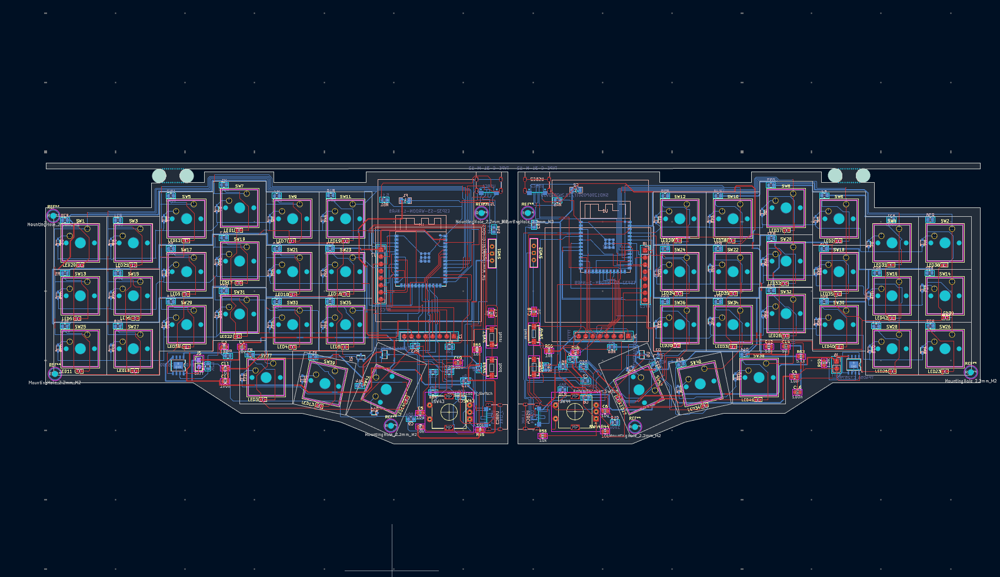

---

## CAD Design

The keyboard enclosure is modelled in Fusion 360 to accommodate the custom PCB, switches, displays, rotary encoders, and internal electronics.

### Enclosure

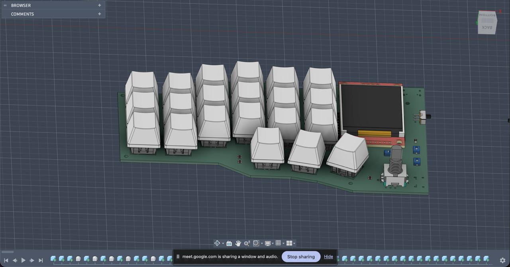

### Complete Assembly

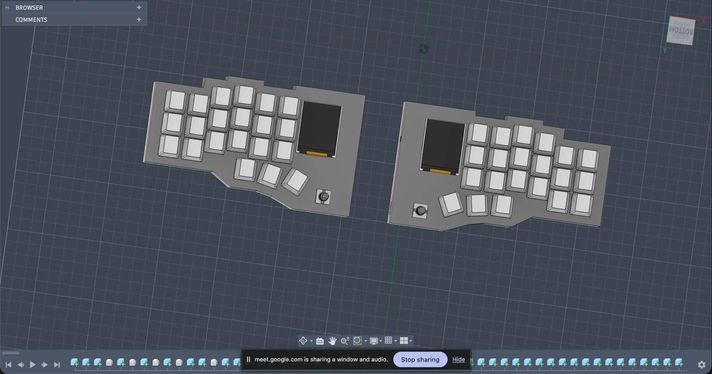

---

## Firmware Status

This firmware was written by me and ahead of physical hardware assembly and has not yet been tested on the actual PCB. Once the hardware build is complete, I will flash the boards, test all peripherals in real time, and fine-tune the code to ensure everything runs flawlessly. I make sure to update the firmware as soon as I  will done with the hardware and make the optimised firmware for this project.

---

## Display, Backlight, and NFC Features

These are the additional features I added to this project:
* **Display:** 1.8-inch SPI TFT display (shows live battery status, backlight percentage, active layer, and NFC UIDs)
* **Backlight:** 0603 SMD LEDs (controlled via the rotary encoder with PWM dimming and wireless sync)
* **NFC:** RC522 NFC Mini Module (connected via SPI for tag scanning)

These features were extremely challenging to implement alongside the wireless split keyboard stack, but I worked hard to integrate them into the firmware. The firmware is currently in the testing phase—all proper on-board checks and final sanity testing will be completed once the physical hardware is assembled.

## AI Declaration
I completed the hardware design, schematic capture, PCB layout, and 3D CAD modeling myself alongside guidance from **Mr. Chronos**. For the firmware, I wrote the complete C++ codebase myself and used AI strictly as a final sanity check to debug and verify the code before flashing.

## Bill of Materials (BOM)

The following table lists the components required to build the split mechanical keyboard, including specifications, quantities, estimated costs, and sourcing links.

### Component Breakdown

| Item | Qty | Supplier | Cost/item | Total Cost | Link |
| :--- | :--- | :--- | :--- | :--- | :--- |
| ESP32-S3-WROOM-1 Module | 2 | Robu.in | $6.03 | $12.06 | [Buy](https://robu.in/product/espressif-esp32-s3-wroom-1-n16r8-module/) |
| NFC RFID Reader | 2 | IndianHobbyCenter | $1.47 | $2.94 | [Buy](https://www.indianhobbycenter.com/products/rc522-mini-rfid-reader-writer-spi-s50-with-rfid-card-and-tag) |
| PCB | 1 | Zbotic | $45.00 | $45.00 | [Buy](https://zbotic.in/) |
| 1.8" TFT Display | 2 | Robu.in | $3.28 | $6.56 | [Buy](https://robu.in/product/62060/) |
| Cherry MX2A Mechanical Switches | 42 | meckeys | $0.41 | $17.22 | [Buy](https://meckeys.com/shop/accessories/keyboard-accessories/key-switches/cherry-mx2a-switch/) |
| 1N4148WS SMD Diodes (SOD-323) | 42 | surnom.com | $0.01 | $0.42 | [Buy](https://www.sunrom.com/p/1n4148---1n4148ws---t4---smd---sod323-0805) |
| EC11 Rotary Encoder | 2 | robu.in | $0.61 | $1.22 | [Buy](https://robu.in/product/hongyan-ec11h-7ce15p1zd15f7-rotary-encoder-with-push-button-switch-vertical-plug-in-5-pin-360-degree/) |
| 0805 SMD Backlight LEDs | 42 | ktron.in | $0.01 | $0.42 | [Buy](https://www.ktron.in/product/smd-white-led-0805-package/) |
| AO3400A N-Channel MOSFET | 2 | robu.in | $0.06 | $0.12 | [Buy](https://robu.in/product/1-month-warranty-414/) |
| SMD 16-pin connector | 4 | ktron.in | $0.06 | $0.24 | [Buy](https://www.ktron.in/product/16-pin-usb-type-c-connector-smd/) |
| 10,000 mAh LiPo Battery | 2 | makerbazar.in | $4.23 | $8.46 | [Buy](https://makerbazar.in/products/single-cell-3-7v-10000mah-lipo-battery) |
| TP4056 IC | 2 | ktron.in | $0.05 | $0.10 | [Buy](https://www.ktron.in/product/tp4056-ic/) |
| ME6211A33M3G IC | 2 | Robu.in | $0.08 | $0.16 | [Buy](https://robu.in/product/me6211c33m5g-n-microne-500ma-fixed-3-3v-positive-electrode-6v-sot-23-5-voltage-regulators-linear-low-drop-out-ldo-regulators-rohs/) |
| SMD1206P050TF/13.2 (PTC) | 2 | Robu.in | $0.10 | $0.20 | [Buy](https://robu.in/product/smd1206-050c-6v-bnstar-6v-40a-500ma-1a-1206-resettable-rohs/) |
| SMD Push Switches | 4 | Robu.in | $0.05 | $0.20 | [Buy](https://robu.in/product/tsa043a2026a-bzcn-3x4x2-5-50ma-round-button-50gf-12v-smd-tactile-switches-rohs/) |
| Slide Switch | 2 | Robu.in | $0.03 | $0.06 | [Buy](https://robu.in/product/1-month-warranty-254/) |
| 100Ω Resistor | 42 | ktron.in | $0.01 | $0.42 | [Buy](https://www.ktron.in/product/resistor-100-ohms-1-1-8w-smd-0805/) |
| 10kΩ Resistor | 12 | ktron.in | $0.01 | $0.12 | [Buy](https://www.ktron.in/product/resistor-10k-ohms-1-1-8w-smd-0805/) |
| 56kΩ Resistor | 4 | ktron.in | $0.01 | $0.04 | [Buy](https://www.ktron.in/product/resistor-56k-ohms-1-1-8w-smd-0805/) |
| 5.1kΩ Resistor | 4 | ktron.in | $0.01 | $0.04 | [Buy](https://www.ktron.in/product/resistor-5k1-ohms-5-1-8w-smd-0805/) |
| 1.2kΩ Resistor | 2 | ktron.in | $0.01 | $0.02 | [Buy](https://www.ktron.in/product/resistor-1k2-ohms-1-1-8w-smd-0805/) |
| 10µF Capacitor | 10 | ktron.in | $0.08 | $0.80 | [Buy](https://www.ktron.in/product/10uf-50v-multi-layered-ceramic-capacitor-mlcc-x5r-smd-0805-yageo-cc0805kkx5r9bb106/) |
| 1µF Capacitor | 2 | ktron.in | $0.09 | $0.18 | [Buy](https://www.ktron.in/product/1uf-50v-multi-layered-ceramic-capacitor-yageo/) |
| 100nF Capacitor | 8 | ktron.in | $0.01 | $0.08 | [Buy](https://www.ktron.in/product/100nf-25v-multi-layered-ceramic-capacitor/) |
| Estimated total shipping | 1 | | | $0.00 | |
| **Grand Total** | | | | **$97.08** | |

## Tools & Technologies

- **PCB Design:** KiCad
- **CAD Modelling:** Fusion 360
- **Firmware:** Cpp, ESP-IDF, FreeRTOS
- **Microcontroller:** ESP32-S3
- **PCB Manufacturing:** Zbotic